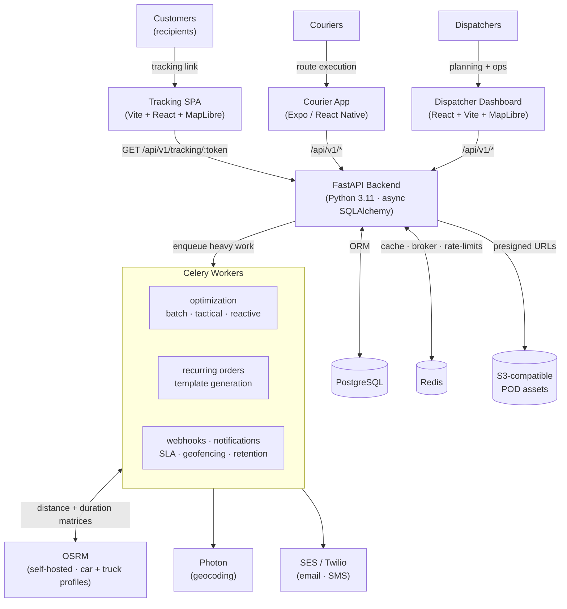
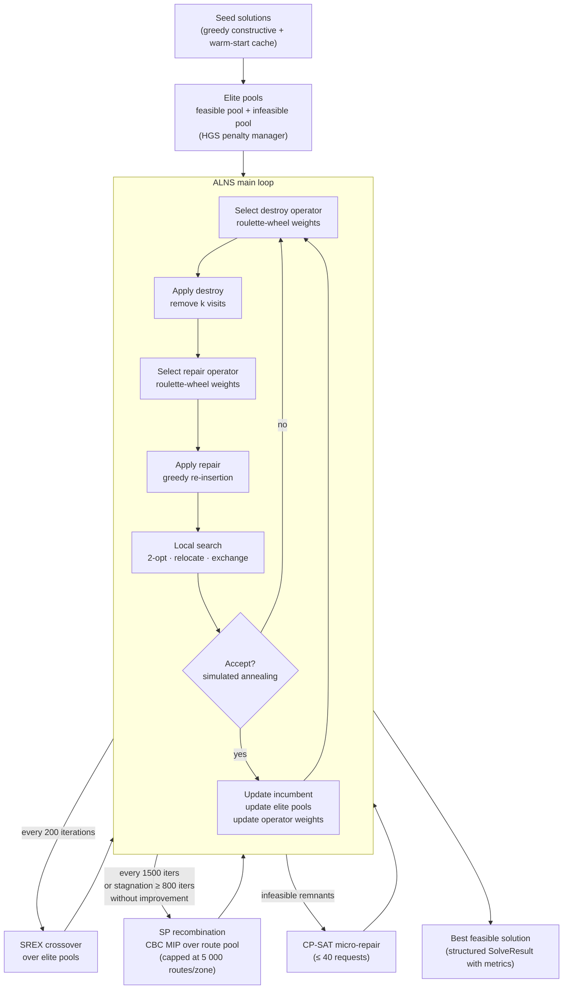
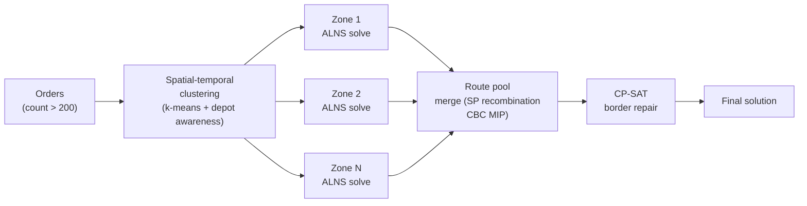
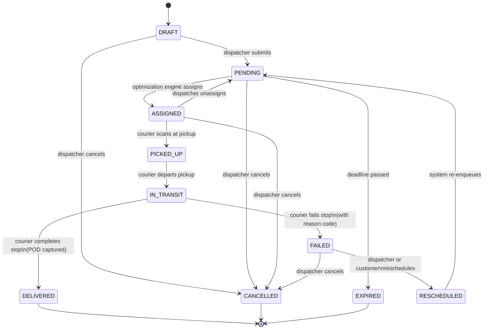
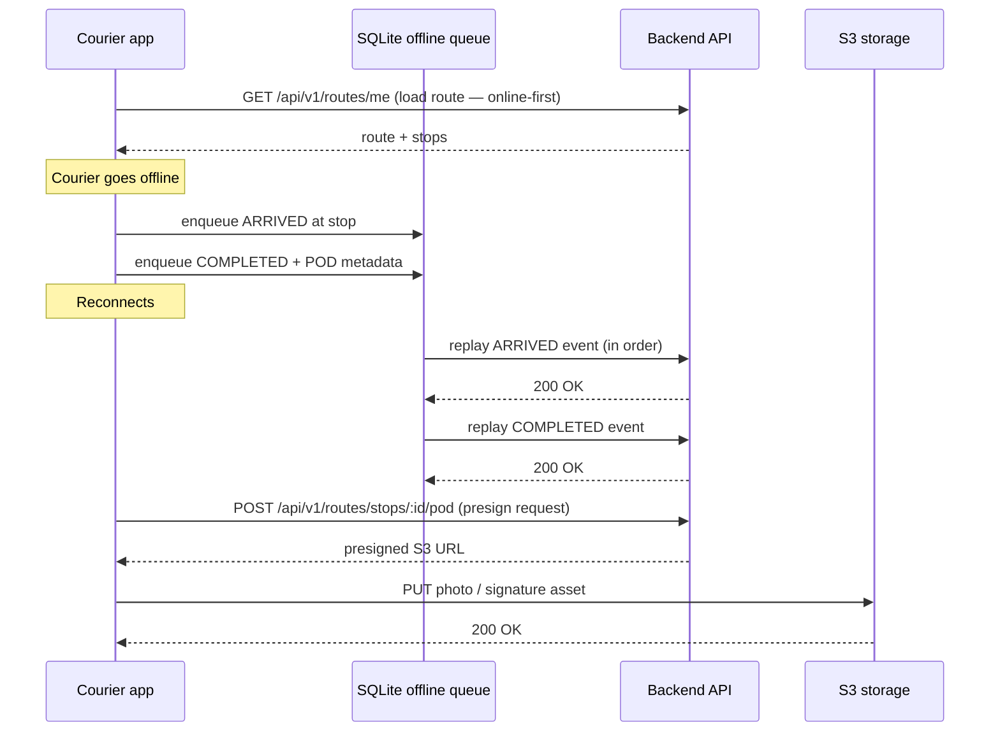
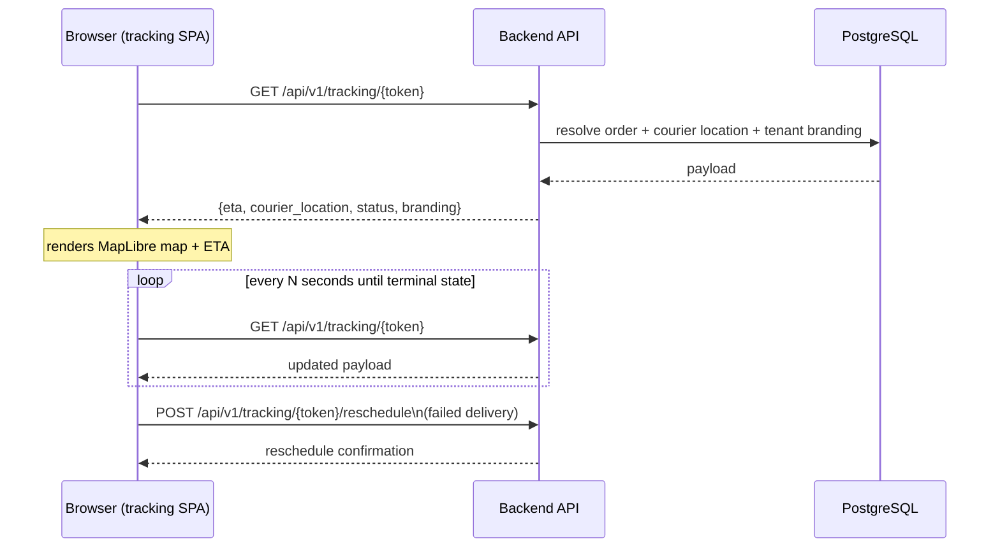

# Last Mile Delivery — Technical Architecture

**Last updated:** May 2026 | **Scope:** Entire monorepo | **Method:** Repository-wide mapping

---

## Table of contents

1. [What this is](#1-what-this-is)
2. [System architecture overview](#2-system-architecture-overview)
3. [The routing engine](#3-the-routing-engine)
   - [3.1 Algorithm stack](#31-algorithm-stack)
   - [3.2 Internal loop diagram](#32-internal-loop-diagram)
   - [3.3 Decomposition — what runs at what scale](#33-decomposition--what-runs-at-what-scale)
   - [3.4 Three rolling-horizon modes](#34-three-rolling-horizon-modes)
   - [3.5 Comparison overlay](#35-comparison-overlay)
   - [3.6 Telemetry visible to dispatchers](#36-telemetry-visible-to-dispatchers)
4. [Order lifecycle](#4-order-lifecycle)
5. [Fleet & constraints model](#5-fleet--constraints-model)
6. [Mobile courier app](#6-mobile-courier-app)
7. [Customer tracking SPA](#7-customer-tracking-spa)
8. [Multi-tenancy, auth, security](#8-multi-tenancy-auth-security)
9. [Data, integrations, ops](#9-data-integrations-ops)
10. [Stack at a glance](#10-stack-at-a-glance)
- [Appendix A — Local development quick starts](#appendix-a--local-development-quick-starts)
- [Appendix B — Implementation checklist (Sections 5–15)](#appendix-b--implementation-checklist-sections-515)
- [Appendix C — Repository map](#appendix-c--repository-map)
- [Appendix D — Markdown elsewhere in the repo](#appendix-d--markdown-elsewhere-in-the-repo)

---

## 1. What this is

Last Mile Delivery is a multi-tenant, API-first last-mile logistics platform. A dispatcher uploads orders and vehicle constraints; the routing engine assigns orders to couriers and plans routes; couriers execute on a mobile app; customers track their delivery on a lightweight SPA.

**Four user-facing surfaces:**
- **Dispatcher dashboard** — React SPA for order management, route planning, live ops monitoring, fleet configuration, analytics, and settings (OIDC, RBAC, webhooks, API keys).
- **Courier mobile app** — Expo / React Native app for route execution, barcode-verified pickup, photo + signature POD, and offline event replay.
- **Customer tracking SPA** — Vite + React page served under a per-order JWT link. Shows live courier location, ETA, and tenant branding. Reschedule form for failed deliveries.
- **Admin / settings surface** — Embedded in the dispatcher dashboard; manages SSO providers, role permissions, audit log, data retention, and demo mode.

**Architecture choices:** multi-tenant by default (all data scoped to `tenant_id`), single-region pilot topology, OpenAPI-documented HTTP surface, self-hosted OSRM for routing matrices, and an open-source Python + React + Expo stack deployable to AWS ECS + RDS + ElastiCache.

---

## 2. System architecture overview



*Macro flow: dispatcher uploads orders → routing engine (Celery worker) plans them into routes → courier app executes and uploads POD → tracking SPA shows live status to recipients.*

---

## 3. The routing engine

The routing layer was fully rewritten in the Rich VRP milestone series (M0–M9). The production engine is a hybrid ALNS + HGS + SP-recombination + CP-SAT stack. OR-Tools CVRPTW is still available for the comparison overlay (see §3.5) but is not in the primary runtime path.

Architecture reference: [VRP_REWRITE_PLAN.md](VRP_REWRITE_PLAN.md).

---

### 3.1 Algorithm stack

| Component | Role | Reference |
|---|---|---|
| **Rich ALNS engine** | Primary search loop — iterative destroy → repair → local search → simulated-annealing accept | [rich_vrp/alns/engine.py](backend/app/algorithms/rich_vrp/alns/engine.py) |
| **HGS elite population** | Feasible + infeasible solution pools; SREX crossover; adaptive penalty manager targets ~65% feasibility offspring | [rich_vrp/hgs/](backend/app/algorithms/rich_vrp/hgs/) |
| **Route-pool SP recombination** | Set-partitioning MIP over accumulated routes (OR-Tools CBC); re-assembles best columns into a new solution | [rich_vrp/recombination/sp_repair.py](backend/app/algorithms/rich_vrp/recombination/sp_repair.py) |
| **CP-SAT micro-repair** | Exact repair on small neighbourhoods (up to 40 requests per call) | [rich_vrp/recombination/cp_sat_repair.py](backend/app/algorithms/rich_vrp/recombination/cp_sat_repair.py) |
| **Cython evaluator** | Compiled feasibility hot path — forward/backward pass + pickup-delivery insertion check | [rich_vrp/local_search/evaluator_cpp/](backend/app/algorithms/rich_vrp/local_search/evaluator_cpp/) |
| **OR-Tools CVRPTW (legacy)** | Comparison-overlay benchmark only; not in the primary runtime path | [vrp_solver.py](backend/app/algorithms/vrp_solver.py) |
| **Human-dispatcher baseline** | Sweep heuristic — comparison benchmark | [human_dispatcher_baseline.py](backend/app/algorithms/human_dispatcher_baseline.py) |

**Lexicographic objective** (in priority order): minimize unserved orders → minimize lateness + overtime → minimize generalised economic cost (distance + labor + fuel + fixed-route cost) → minimize deviation from the warm-start solution. Unserved orders dominate every other criterion — the engine will accept a longer, more expensive plan if it serves one more stop.

**Destroy operators:** random removal, Shaw removal (similarity-based), worst-cost removal, route elimination, time-window cluster removal, compatibility-conflict removal.

**Local-search neighbourhoods:** relocate, relocate-pair, exchange (1,1) / (2,1) / (2,2), 2-opt intra-route, 2-opt* inter-route, cross-exchange, optional-order drop, compatibility-conflict repair.

---

### 3.2 Internal loop diagram



*Source: [rich_vrp/alns/engine.py](backend/app/algorithms/rich_vrp/alns/engine.py) — `ALNSConfig` defaults: `crossover_interval=200`, `sp_interval=1500`, `stagnation_threshold=800`.*

---

### 3.3 Decomposition — what runs at what scale

The engine switches to decomposed mode when order count exceeds `DECOMP_THRESHOLD = 200` ([decomposition/clustering.py:26](backend/app/algorithms/rich_vrp/decomposition/clustering.py)). Below the threshold it runs as a single ALNS instance; above it the [decompose_and_solve pipeline](backend/app/algorithms/rich_vrp/decomposition/pipeline.py) clusters → solves zones in parallel → recombines via SP → repairs border stops.

| Scale | Strategy | Matrix | Solve mode | Typical time budget |
|---|---|---|---|---|
| **40–100 orders** | No decomposition | Dense full | Single ALNS run | 5–15 s |
| **100–500 orders** | 2–8 zones, spatial-temporal clustering | Dense per zone | Parallel ALNS + border SP | 15–60 s |
| **500–2 000 orders** | Hierarchical zone decomposition | Dense per zone, sparse global | Parallel ALNS + SP + CP border | 1–3 min |
| **2 000–10 000 orders** | Zone + rolling horizon + depot-aware clustering | Sparse global | Parallel zone solves with route pools | 3–25 min |
| **10 000–100 000 orders** | Regional decomposition + portal graph | Never full global | Distributed zone solves + multi-stage SP | 15–60 min |



*Source: [decomposition/pipeline.py](backend/app/algorithms/rich_vrp/decomposition/pipeline.py), [decomposition/clustering.py](backend/app/algorithms/rich_vrp/decomposition/clustering.py).*

---

### 3.4 Three rolling-horizon modes

| Mode | When it runs | What it does | Entry point |
|---|---|---|---|
| **Batch** | Pre-wave / overnight | Full plan from scratch using all pending orders and available vehicles | `RichALNSAdapter.solve()` |
| **Tactical** | Every 15–60 min during the active wave | Replans un-started routes; keeps in-progress vehicles frozen at current stop | `RichALNSAdapter.solve_tactical()` |
| **Reactive** | Event-triggered (cancellation, late add, vehicle breakdown) | Local repair on only the changed requests; other routes unchanged | `RichALNSAdapter.solve_reactive()` |

*Source: [rich_vrp/decomposition/rolling_horizon.py](backend/app/algorithms/rich_vrp/decomposition/rolling_horizon.py), [adapters/rich_alns.py](backend/app/algorithms/adapters/rich_alns.py).*

---

### 3.5 Comparison overlay

The dispatcher's **Run Comparison** button runs all six scenarios against the same day's orders and shows results side-by-side. Each scenario produces an `EconomicCostBreakdown` (distance / labor / fuel / fixed / lateness / overtime / unserved penalty) plus an on-time percentage.

| Scenario key | Solver | Objective | Fleet mode |
|---|---|---|---|
| `human_dispatcher_baseline` | Sweep heuristic | Service-first | Full fleet |
| `fuel_aware_full_fleet` | OR-Tools CVRPTW | Fuel-aware | Full fleet |
| `fuel_aware_efficient` | OR-Tools CVRPTW | Fuel-aware | Efficient |
| `service_first_full_fleet` | OR-Tools CVRPTW | Service-first | Full fleet |
| `service_first_efficient` | OR-Tools CVRPTW | Service-first | Efficient |
| `rich_alns_service_first` | **Rich ALNS** (production) | Service-first | Full fleet |

*Source: [services/route_scenario_service.py](backend/app/services/route_scenario_service.py) — `SCENARIO_DEFINITIONS`.*

---

### 3.6 Telemetry visible to dispatchers

The Rich ALNS scenario panel in the comparison overlay surfaces the following metrics from each solve:

- **total_iterations** / **accepted_iterations** / **improving_iterations** — search intensity and convergence signal.
- **feasibility_ratio** — fraction of elite offspring that are feasible; the adaptive penalty manager targets ≈ 0.65 ([hgs/penalty.py](backend/app/algorithms/rich_vrp/hgs/penalty.py)).
- **route_pool_size** — routes accumulated across the run; capped at 5 000 per zone ([recombination/route_pool.py](backend/app/algorithms/rich_vrp/recombination/route_pool.py)).
- **engine_failed** / **engine_overtime** / **unserved_urgent_count** — structured failure indicators. `engine_overtime` fires when elapsed time exceeds `1.2 × time_budget_s` ([adapters/rich_alns.py](backend/app/algorithms/adapters/rich_alns.py)). No silent fallback to OR-Tools occurs; failures surface as green / amber / red badges.

---

## 4. Order lifecycle



| Transition | Who triggers it |
|---|---|
| DRAFT → PENDING | Dispatcher API / bulk import |
| PENDING → ASSIGNED | Optimization engine (dispatch service) |
| ASSIGNED → PICKED_UP | Courier mobile (barcode scan at pickup) |
| PICKED_UP → IN_TRANSIT | Courier mobile (depart action) |
| IN_TRANSIT → DELIVERED | Courier mobile (stop completion + POD) |
| IN_TRANSIT → FAILED | Courier mobile (fail stop with reason) |
| FAILED → RESCHEDULED | Dispatcher API or customer reschedule link |
| RESCHEDULED → PENDING | System trigger (recurring order service) |
| Any → CANCELLED | Dispatcher API |

**Recurring orders:** templates define a cadence (daily/weekly); the `recurring_order_tasks` Celery worker generates occurrences ahead of time and injects them as PENDING orders. Source: [recurring_order_service.py](backend/app/services/recurring_order_service.py).

---

## 5. Fleet & constraints model

Every routing constraint is modelled in the [rich_vrp/domain/models.py](backend/app/algorithms/rich_vrp/domain/models.py) domain layer and enforced by the Cython evaluator's forward/backward pass.

| Constraint | Where it is modelled |
|---|---|
| Vehicle capacity (weight, volume, package count) | `Vehicle.capacity_grams` / `Vehicle.max_stops` |
| Time windows — hard + soft (preferred) | `Request.earliest / latest / hard_latest_time_s` |
| Pickup-delivery precedence | Every `Request` carries `pickup_node` and `delivery_node`; PD order enforced natively |
| Vehicle-order compatibility tags | `Request.required_tags ⊆ Vehicle.tags` |
| Multi-trip (depot reload between trips) | Virtual trip slots — depot reload modelled as a return arc |
| Driver shift windows + overtime penalty | `Vehicle.shift_window`, `Vehicle.hard_shift_end`, `cost.overtime_per_min` |
| Maximum route distance | `Vehicle.max_distance_m` |
| Driver breaks | `Vehicle.break_window`, `Vehicle.break_duration_s` |
| Optional orders (drop allowed at penalty) | `Request.optional = True`, `Request.unserved_penalty` |
| Depot graph (multiple depots, depot-to-depot edges) | [depot_edges API](backend/app/api/depot_edges.py) + `depot_edge_service.py` |
| Vehicle routing profiles (car, van, motorcycle, bicycle) | `Vehicle.profile` — profile-specific OSRM distance/duration matrices |
| Candidate neighbour list size | `k = 24` nearest neighbours for local-search moves ([local_search/candidate_lists.py](backend/app/algorithms/rich_vrp/local_search/candidate_lists.py)) |

---

## 6. Mobile courier app



*Route start and loading checklist remain online-first by design. Only stop-level events (arrive / complete / fail / POD) are queued for offline replay.*

**Key modules:** [offlineQueue.ts](mobile/src/services/offlineQueue.ts) (SQLite-backed replay), [pod.ts](mobile/src/services/pod.ts) (presigned uploads), [BarcodeScannerModal](mobile/src/components/BarcodeScannerModal.tsx), [SignaturePadModal](mobile/src/components/SignaturePadModal.tsx), [locationService.ts](mobile/src/services/locationService.ts), [pushService.ts](mobile/src/services/pushService.ts).

---

## 7. Customer tracking SPA



The tracking token is a single-purpose JWT scoped to one order. It expires when the order reaches a terminal state (DELIVERED, CANCELLED, or EXPIRED). The SPA renders the courier's current location on a MapLibre map, shows the ETA, and injects tenant branding (logo, colours) from the API payload — no separate branding endpoint call needed.

*Source: [tracking.py](backend/app/api/tracking.py), [tracking_service.py](backend/app/services/tracking_service.py), [eta_service.py](backend/app/services/eta_service.py).*

---

## 8. Multi-tenancy, auth, security

| Capability | Mechanism | Reference |
|---|---|---|
| Tenant isolation | Async SQLAlchemy session-scoped `tenant_id` filter on every query | [tenant_context.py](backend/app/utils/tenant_context.py) |
| Auth (dispatcher / courier) | JWT — access + refresh tokens; single-flight 401 refresh on the client | [auth.py](backend/app/utils/auth.py) |
| SSO | OIDC discovery + JIT user provisioning | [oidc_service.py](backend/app/services/oidc_service.py) |
| RBAC | Permission matrix + per-user overrides | [rbac_service.py](backend/app/services/rbac_service.py) |
| API keys (server-to-server) | Per-tenant scoped keys with capability flags | [api_key_service.py](backend/app/services/api_key_service.py) |
| Customer tracking | One-shot per-order JWT; no dispatcher credentials required | [tracking_service.py](backend/app/services/tracking_service.py) |
| Rate limiting | Redis-backed token bucket | [rate_limit.py](backend/app/utils/rate_limit.py) |
| Audit log | Append-only event stream; searchable UI tab in Settings | [audit_service.py](backend/app/services/audit_service.py) |
| Email verification | Lifecycle service + configurable grace period | [email_verification_service.py](backend/app/services/email_verification_service.py) |
| Demo mode | Read-only sandbox; mutating endpoints return 403 except auth bootstrap | [config.py](backend/app/config.py) `DEMO_MODE` |
| Query profiler | Opt-in slow-query + N+1 detection (`ENABLE_QUERY_PROFILER`) | [query_profiler.py](backend/app/utils/query_profiler.py) |

*Security posture depth: [docs/operations/security.md](docs/operations/security.md). Dedicated security audits (pen-test, SOC2 evidence) are out of scope for this document.*

---

## 9. Data, integrations, ops

| Tier | Components |
|---|---|
| **Datastores** | PostgreSQL (primary — ORM via async SQLAlchemy, Alembic migrations through `20260428_0025_order_scheduled_date`); Redis (cache, Celery broker + backend, RedBeat schedules, rate-limit counters, JWT revocation); S3-compatible (POD photo + signature uploads via presigned URLs) |
| **Routing** | OSRM self-hosted, two routing graphs (car + truck profiles, Istanbul OSM data pre-processed by [prepare_osrm_data.sh](backend/scripts/prepare_osrm_data.sh)); distance + duration matrices fetched per solve and cached in Redis |
| **Geocoding** | Photon (self-hosted or remote); bulk-import pipeline geocodes addresses before matrix assembly |
| **Notifications** | SES (email) + Twilio (SMS) via `notification_service.py` + `notification_tasks.py` Celery worker |
| **Error tracking** | Sentry (optional; `SENTRY_DSN`) |
| **CDN** | AWS CloudFront for dispatcher SPA + tracking SPA bundles |
| **Workers (Celery)** | `optimization_tasks` (batch / week / on-demand solves), `recurring_order_tasks` (template occurrence generation), `webhook_tasks` (outbound delivery + retry), `notification_tasks` (fan-out), `geofencing_tasks`, `sla_tasks` (SLA scan + drift alerts), `retention_tasks` |
| **Public APIs** | OpenAPI at `/docs`; webhook delivery with HMAC signing; per-tenant API keys with capability scopes |
| **Observability** | Structured logs with correlation IDs (`REQUEST_ID_HEADER` + `CORRELATION_ID_HEADER`); optional query profiler; Sentry error capture |

---

## 10. Stack at a glance

| App | Language / framework | Key libraries | Tests |
|---|---|---|---|
| **Backend API** | Python 3.11, FastAPI, SQLAlchemy 2 async, Pydantic v2, Alembic | Celery + RedBeat, OR-Tools, Cython (routing hot path), OSRM client, Photon client | pytest unit + integration; ruff lint; pytest-cov |
| **Dispatcher dashboard** | React 18, TypeScript, Vite, Tailwind CSS, MapLibre GL | i18next, Vitest, Playwright | Vitest component + hook suites; Playwright e2e |
| **Courier mobile** | Expo SDK, React Native, TypeScript | expo-camera, expo-sqlite (offline queue), expo-notifications, signature canvas | Jest + React Testing Library; RTL component tests |
| **Customer tracking SPA** | React 18, TypeScript, Vite, MapLibre GL | i18next, Vitest | Vitest app-level tests |
| **Infrastructure** | Terraform, AWS (ECS, ALB, RDS, ElastiCache, S3, CloudFront) | GitHub Actions CI/CD | terraform fmt / validate / plan; `infra-ci.yml` |

---

## Appendix A — Local development quick starts

Python **3.11** — `.python-version`.

### Backend

```bash
cd backend
python3.11 -m venv .venv && source .venv/bin/activate
pip install -r requirements.txt
docker compose up -d postgres redis
alembic upgrade head
python -m app.seed_demo
uvicorn app.main:app --reload
```

Demo login (seed defaults): `dispatcher@delivery.com` / `changeme123`.

### Dispatcher (`frontend/`)

```bash
cd frontend && npm install && npm run dev
```

`VITE_API_BASE_URL` (defaults `http://localhost:8000`), optional map style keys.

### Courier (`mobile/`)

```bash
cd mobile && npm install && npm run start
```

`EXPO_PUBLIC_API_BASE_URL` for devices.

### Tracking (`tracking/`)

```bash
cd tracking && npm install && npm run dev
```

Typically proxies `/api` → backend (`5175` commonly).

### One-command startup

```bash
bash dev.sh               # backend + dispatcher dashboard
bash dev.sh --tracking    # backend + tracking SPA
bash dev.sh --all         # backend + dashboard + tracking (parallel)
bash dev.sh --stop        # stop all backend Docker services
bash dev.sh --reset       # wipe DB volumes and restart fresh
```

OSRM map data (Istanbul, ~42 MB, ~3–6 min to pre-process) is prompted on first run.

---

## Appendix B — Implementation checklist (Sections 5–15)

### April–May 2026 — substantive deltas vs March snapshot

| Theme | What changed |
|-------|----------------|
| **Recurring orders** | Backend `recurring_orders` API + `recurring_order_service` + Celery `recurring_order_tasks`; Alembic `20260428_0024_recurring_orders`; dispatcher **`RecurringOrdersPage`** (`/recurring-orders`); integration coverage (`test_recurring_orders_live_flow.py`, cadence unit tests). |
| **Dispatcher IA** | Primary shell routes: **Command** (`/` → `LiveOpsPage`), **Orders**, **Recurring**, **Fleet**, **Insights**, **Settings** (admin). Legacy paths **`/couriers` → `/fleet`**, **`/analytics` → `/insights`**, **`/failed-orders` → `/orders`**, **`/sla-alerts` → `/`**, **`/audit-log` → `/settings`**, **`/integrations` → `/settings`** (see [`frontend/src/App.tsx`](frontend/src/App.tsx)). |
| **Fleet / vehicle realism** | `vehicle_specs` API + `vehicle_spec_service`; depot graph **`depot_edges`** + `depot_edge_service`; migrations through **`20260427_0023_routing_realism`** and scheduled-date plumbing (**`20260428_0025_order_scheduled_date`**); dispatcher **`VehicleSpecsTab`**, **`FleetPage`**, **`InsightsPage`**. |
| **Weekly / batch optimization** | `dispatch_week_service`, worker orchestration refinements (`task_dispatch.py`, `optimization_tasks.py`); integration flows (`test_dispatch_week_flow.py`, `test_batch_optimization_creation_live_flow.py`, worker live flows). |
| **Rich VRP rewrite (M0–M9)** | ALNS engine + HGS + SP-recombination + CP-SAT + Cython evaluator replacing OR-Tools as the primary solver; decomposition pipeline for > 200 orders; lexicographic objective; structured failure metrics; OR-Tools decommissioned from runtime path (M9). See [VRP_REWRITE_PLAN.md](VRP_REWRITE_PLAN.md). |
| **Static + mobile CD** | **`web-cd.yml`** — workflow-dispatch deploy **dispatcher** and/or **tracking** to staging/production buckets + CDN invalidation; **`mobile-cd.yml`** — EAS builds across profiles/platforms. |
| **Mobile execution** | **`BarcodeScannerModal`**, **`SignaturePadModal`**, expanded POD flows — older "stub-only" POD/barcode caveats no longer apply; RTL/component tests expanded. |

---

**Tracking columns**

| Column | Meaning |
|--------|---------|
| `owner` | Primary accountable domain |
| `artifact` | Concrete path proving implementation |
| `test_evidence` | Automated tests / commands / CI artefacts |
| `status` | `todo`, `in_progress`, `done`, `blocked` |

### Section 5: Core Modules

| id | deliverable | owner | artifact | test_evidence | status |
|---|---|---|---|---|---|
| 5.1 | Order management + state machine + history | backend | `backend/app/services/order_service.py` | `backend/tests/unit/test_order_state_machine.py` + `backend/tests/integration/test_order_flow.py` | done |
| 5.2 | Courier/fleet constraints + location pipeline | backend | `backend/app/services/courier_service.py` + `backend/app/services/order_service.py` | `backend/tests/integration/test_courier_flow.py` + `backend/tests/unit/test_courier_service_location_cache.py` + `backend/tests/unit/test_order_service_fleet_constraints.py` | done |
| 5.3 | CVRPTW optimization engine + outputs | backend | `backend/app/algorithms/vrp_solver.py` + `backend/app/services/dispatch_service.py` | `backend/tests/unit/test_vrp_solver.py` + `backend/tests/unit/test_dispatch_service_batch_output.py` + `backend/tests/unit/test_dispatch_service_windows.py` | done |
| 5.4 | Dispatch engine (auto + manual + week/batch orchestration) | backend | `backend/app/services/dispatch_service.py` + `backend/app/services/dispatch_week_service.py` | `backend/tests/integration/test_dispatch_flow.py` + `backend/tests/integration/test_dispatch_week_flow.py` + `backend/tests/integration/test_batch_optimization_creation_live_flow.py` | done |
| 5.5 | Tracking service with dynamic ETA | backend | `backend/app/services/tracking_service.py` + `backend/app/services/eta_service.py` | `backend/tests/unit/test_tracking_service_helpers.py` + `backend/tests/integration/test_tracking_flow.py` + `backend/tests/unit/test_eta.py` | done |
| 5.6 | POD photo/signature/barcode lifecycle | backend/mobile | `backend/app/services/route_service.py` + `mobile/src/services/pod.ts` + `mobile/src/screens/StopDetailScreen.tsx` + `mobile/src/components/SignaturePadModal.tsx` + `mobile/src/components/BarcodeScannerModal.tsx` | `backend/tests/unit/test_route_pod_policy.py` + `mobile/src/services/__tests__/pod.test.ts` + RTL/component tests under `mobile/src/screens/__tests__/` + `cd mobile && npm test` | done |
| 5.7 | Notification routing + dedupe + async dispatch | backend | `backend/app/services/notification_service.py` + `backend/app/workers/notification_tasks.py` | `backend/tests/unit/test_notification_service.py` | done |
| 5.8 | Webhook + API key integration layer | backend | `backend/app/api/webhooks.py` + `backend/app/api/api_keys.py` + `backend/app/services/webhook_service.py` | `backend/tests/unit/test_webhook_delivery.py` + `backend/tests/unit/test_webhook_service_delivery.py` + `backend/tests/integration/test_api_key_order_access.py` + `backend/tests/integration/test_webhooks_live_flow.py` | done |
| 5.9 | Failed delivery + rescheduling workflow | backend/frontend | `backend/app/services/route_service.py` + `backend/app/services/failed_delivery_service.py` + `frontend/src/pages/OrdersPage.tsx` | `backend/tests/integration/test_reschedule_flow.py` + `backend/tests/unit/test_route_fail_stop_attempt_limit.py` + `backend/tests/unit/test_failed_delivery_service.py` | done |
| 5.10 | Bulk import + geocoding pipeline | backend | `backend/app/services/import_service.py` + `backend/app/api/orders.py` | `backend/tests/unit/test_import_service.py` | done |
| 5.11 | Geofencing + auto status triggers | backend | `backend/app/services/geofencing_service.py` + `backend/app/workers/geofencing_tasks.py` | `backend/tests/unit/test_geofencing_service.py` | done |
| 5.12 | Analytics + reporting + exports | backend/frontend | `backend/app/api/analytics.py` + `backend/app/services/analytics_service.py` + `frontend/src/pages/InsightsPage.tsx` | `backend/tests/integration/test_analytics_api.py` + `cd frontend && npm test` | done |
| **5.13** | **Recurring order templates + occurrences + worker generation** | **backend** | **`backend/app/services/recurring_order_service.py` + `backend/app/api/recurring_orders.py` + `backend/app/workers/recurring_order_tasks.py`** | **`backend/tests/integration/test_recurring_orders_live_flow.py` + `backend/tests/unit/test_recurring_order_cadence.py`** | **done** |

### Section 6: Algorithms

| id | deliverable | owner | artifact | test_evidence | status |
|---|---|---|---|---|---|
| 6.1 | CVRPTW implementation (+ optional **`two_opt.py`** polishing stage co-deployed with solver outputs) | backend | `backend/app/algorithms/vrp_solver.py` + `backend/app/algorithms/two_opt.py` | `backend/tests/unit/test_vrp_solver.py` + `backend/tests/unit/test_two_opt.py` | done |
| 6.2 | On-demand insertion heuristic | backend | `backend/app/algorithms/insertion_heuristic.py` | `backend/tests/unit/test_insertion_heuristic.py` | done |
| 6.3 | Distance matrix + cache | backend | `backend/app/algorithms/osrm_client.py` | `backend/tests/unit/test_distance_matrix.py` + `backend/tests/unit/test_distance_matrix_runtime_cache.py` | done |
| 6.4 | ETA calculation engine | backend | `backend/app/services/eta_service.py` + `backend/app/services/tracking_service.py` | `backend/tests/unit/test_eta.py` + `backend/tests/integration/test_tracking_flow.py` | done |
| 6.5 | Re-optimization policy | backend | `backend/app/workers/optimization_tasks.py` + `backend/app/services/dispatch_service.py` | `backend/tests/unit/test_reoptimization_policy.py` + `backend/tests/integration/test_dispatch_flow.py` + `backend/tests/integration/test_reoptimization_live_flow.py` | done |
| 6.6 | Geofence arrival detection | backend | `backend/app/services/geofencing_service.py` | `backend/tests/unit/test_geofencing_service.py` | done |

### Section 7: Database Schema

| id | deliverable | owner | artifact | test_evidence | status |
|---|---|---|---|---|---|
| 7.1 | Complete relational schema with migrations | backend | `backend/migrations/versions/*.py` through **`20260428_0025_order_scheduled_date.py`** | `cd backend && alembic upgrade head` + `backend/tests/unit/test_migration_style.py` | done |
| 7.2 | Indexes and constraints parity | backend | `backend/migrations/versions/20260224_0007_schema_parity_indexes_constraints.py` + `backend/scripts/schema_inspection_checks.py` | `python3 scripts/schema_inspection_checks.py` | done |

### Section 8: API Design

| id | deliverable | owner | artifact | test_evidence | status |
|---|---|---|---|---|---|
| 8.1 | Auth endpoints incl. logout/revocation | backend | `backend/app/api/auth.py` + `backend/app/utils/auth.py` | `backend/tests/integration/test_auth_flow.py` + `backend/tests/unit/test_auth.py` + `backend/tests/unit/test_rate_limit.py` | done |
| 8.2 | Orders endpoints incl. history/import | backend | `backend/app/api/orders.py` | `backend/tests/integration/test_api_key_order_access.py` + `backend/tests/integration/test_order_flow.py` + `backend/tests/unit/test_import_service.py` | done |
| 8.3 | Courier endpoints incl. analytics hooks | backend | `backend/app/api/couriers.py` | `backend/tests/integration/test_courier_flow.py` | done |
| 8.4 | Routes endpoints incl. optimize aliases | backend | `backend/app/api/routes.py` | `backend/tests/integration/test_route_flow.py` + `backend/tests/integration/test_dispatch_flow.py` | done |
| 8.5 | Tracking public API | backend | `backend/app/api/tracking.py` | `backend/tests/integration/test_tracking_flow.py` | done |
| 8.6 | Webhook/API-key admin APIs | backend | `backend/app/api/webhooks.py` + `backend/app/api/api_keys.py` | `backend/tests/unit/test_webhook_delivery.py` + `backend/tests/integration/test_api_key_order_access.py` | done |
| 8.7 | Analytics APIs | backend | `backend/app/api/analytics.py` | `backend/tests/integration/test_analytics_api.py` | done |
| **8.8** | **Recurring-order template APIs** | **backend** | **`backend/app/api/recurring_orders.py`** | **`backend/tests/integration/test_recurring_orders_live_flow.py`** | **done** |

### Section 9: Folder Structure

| id | deliverable | owner | artifact | test_evidence | status |
|---|---|---|---|---|---|
| 9.1 | Backend structure parity | backend | `backend/app/*` | static audit | done |
| 9.2 | Frontend scaffold + pages | frontend | `frontend/src/App.tsx` + `frontend/src/pages/*` | `cd frontend && npm run build` + `cd frontend && npm test` | done |
| 9.3 | Mobile scaffold + services | mobile | `mobile/src/navigation/AppNavigator.tsx` + `mobile/src/services/offlineQueue.ts` | `cd mobile && npm run typecheck` + `cd mobile && npm test` | done |
| 9.4 | Tracking scaffold | frontend | `tracking/src/App.tsx` | `cd tracking && npm run build` + `cd tracking && npm test` | done |

### Section 10: Interfaces

| id | deliverable | owner | artifact | test_evidence | status |
|---|---|---|---|---|---|
| 10.1 | Dispatcher dashboard UI | frontend | `frontend/src/pages/LiveOpsPage.tsx` + `frontend/src/pages/OrdersPage.tsx` + `frontend/src/pages/RecurringOrdersPage.tsx` + `frontend/src/pages/FleetPage.tsx` + `frontend/src/pages/InsightsPage.tsx` + `frontend/src/hooks/usePolling.ts` + `frontend/src/hooks/useCourierLocations.ts` | `cd frontend && npm run build` + Live Ops / Orders / Recurring Vitest suites | done |
| 10.2 | Courier mobile app | mobile | `mobile/src/screens/MyRouteScreen.tsx` + `mobile/src/screens/StopDetailScreen.tsx` + `mobile/src/screens/LoadingChecklistScreen.tsx` + `mobile/src/services/offlineQueue.ts` | mobile unit + RTL tests + `docs/operations/runbooks/mobile_offline_replay.md` | done |
| 10.3 | Customer tracking page | frontend | `tracking/src/App.tsx` | `cd tracking && npm run build` + `cd tracking && npm test` | done |

### Section 11: Infrastructure & Deployment

| id | deliverable | owner | artifact | test_evidence | status |
|---|---|---|---|---|---|
| 11.1 | AWS architecture IaC | platform | `infra/terraform/bootstrap/*` + `infra/terraform/aws/modules/*` + `infra/scripts/terraform_validate.sh` + `.github/workflows/infra-ci.yml` + `.github/workflows/infra-plan.yml` | fmt/init/validate + plans | in_progress |
| 11.2 | Cost optimization controls | platform | `docs/operations/cost_strategy.md` + `infra/terraform/aws/budgets.tf` + `infra/scripts/monthly_cost_report.sh` + `.github/workflows/cost-report.yml` | fixture scripts + workflow artefacts | in_progress |
| 11.3 | Monitoring/observability | platform | `infra/terraform/aws/monitoring.tf` + `backend/app/main.py` + `docs/operations/monitoring_observability.md` + `infra/scripts/validate_required_alarms.sh` | alarm fixtures + drill logs | in_progress |
| 11.4 | CI/CD pipeline | platform | `.github/workflows/backend-ci.yml` + `reusable-backend-ci.yml` + `backend-cd.yml` + `web-mobile-ci.yml` + `reusable-web-mobile-ci.yml` + **`web-cd.yml`** + **`mobile-cd.yml`** + `infra-ci.yml` + `infra-plan.yml` + `release-readiness.yml` + `reusable-release-readiness.yml` + `workflow-lint.yml` + `release-drafter-workflow.yml` + `docs/operations/ci_cd_pipeline.md` + `infra/scripts/check_section11_evidence.sh` | CI runs + migration gates + Section 11 ledger compatibility | in_progress |

### Section 12: Security

| id | deliverable | owner | artifact | test_evidence | status |
|---|---|---|---|---|---|
| 12.1 | AuthN/AuthZ hardening | backend | `backend/app/utils/auth.py` + `backend/app/utils/access.py` | `backend/tests/integration/test_auth_flow.py` + `backend/tests/integration/test_api_key_order_access.py` | done |
| 12.2 | Rate limiting + audit logs | backend | `backend/app/utils/rate_limit.py` + `backend/app/services/audit_service.py` | `backend/tests/unit/test_rate_limit.py` + `backend/tests/unit/test_audit_service.py` | done |
| 12.3 | Data security + retention | backend/platform | `docs/operations/security.md` + `backend/app/services/data_retention_service.py` | `backend/tests/unit/test_data_retention_service.py` + retention worker tests | done |

### Section 13: Courier Offline Mode

| id | deliverable | owner | artifact | test_evidence | status |
|---|---|---|---|---|---|
| 13.1 | Offline queue + replay | mobile | `mobile/src/services/offlineQueue.ts` + `mobile/src/services/pod.ts` | `mobile/src/services/__tests__/offlineQueue.test.ts` + replay runbook | done |

### Section 14: Implementation Phases

| phase | target | owner | artifact | test_evidence | status |
|---|---|---|---|---|---|
| Phase 0 | Codebase hardening | backend/frontend/mobile | ruff/pytest/vitest configs | CI suites | done |
| Phase 1 | Foundation complete | backend | `backend/*` | integration suites | done |
| Phase 2 | Optimization complete | backend | `backend/app/algorithms/*` | solver + insertion + two-opt tests | done |
| Phase 3 | Mobile + POD complete | mobile/backend | barcode/signature/POD pipeline | mobile tests | done |
| Phase 4 | Integrations + tracking | backend/tracking | APIs + SPA | tracking tests | done |
| Phase 5 | Dashboard + analytics | frontend/backend | Insights surfaces | Vitest + analytics integration | done |
| Phase 6 | Ops + infra polish | platform | SLA + infra workflows | infra-ci | done |
| Phase 7 | Security hardening | backend | RBAC + audit + rate limits | unit/integration suites | done |
| Phase 8 | Enterprise features | backend | OIDC/RBAC/email verification/query profiler | OIDC integration tests | done |

### Section 15: Design Decisions Summary

| id | decision | owner | artifact | test_evidence | status |
|---|---|---|---|---|---|
| 15.1 | Modular monolith retained | architecture | `docs/adr/0001-modular-monolith.md` | ADR | done |
| 15.2 | OR-Tools CVRPTW (comparison overlay) | architecture | `docs/adr/0002-ortools-cvrptw.md` | benchmarks | done |
| 15.3 | Self-hosted OSRM retained | architecture | `docs/adr/0003-osrm-self-hosted.md` | matrix tests | done |
| 15.4 | JWT tracking links retained | architecture | `docs/adr/0004-jwt-tracking-links.md` | tracking integration tests | done |

*Note: ADR 0002 pre-dates the Rich VRP rewrite. OR-Tools is now the comparison-overlay solver, not the primary runtime. The de-facto architecture ADR for the new stack is [VRP_REWRITE_PLAN.md](VRP_REWRITE_PLAN.md).*

---

## Appendix C — Repository map

**Automation:** `infra/scripts/check_section11_evidence.sh` defaults to `README.md` (`SECTION11_CHECKLIST_PATH` overrides). CI path filters in `backend-ci.yml` and `infra-ci.yml` watch `README.md` and `docs/operations/evidence/section11/**`.

### Monorepo layout (top level)

| Path | What it is |
|------|------------|
| `README.md` | **This file** — architecture, checklist Appendix B, quick starts |
| `backend/` | Python API, workers, migrations, tests, `Dockerfile`, `docker-compose` |
| `frontend/` | Vite + React **dispatcher dashboard** |
| `mobile/` | Expo + React Native **courier app** |
| `tracking/` | Vite + React **customer tracking** SPA |
| `shared/` | Generated **`api-schema.generated.ts`** (OpenAPI-aligned shared types / paths) |
| `infra/` | Terraform (`terraform/`), validation scripts (`scripts/`) |
| `docs/` | Runbooks, ADRs, policies, Section 11 evidence ledger |
| `.github/workflows/` | CI/CD and promotion gates |

### Backend (`backend/`)

#### Application entry and wiring

| File | Role |
|------|------|
| `app/main.py` | FastAPI: **CORS**, logging, security headers, global handlers; mounts routers; `GET /health`; **lifespan startup checks** (JWT secrets, dry-run flags, localhost URL guards, Alembic head); optional query profiler |
| `app/config.py` | Pydantic settings: DB, Redis, JWT, S3, OSRM, Photon, Celery, Sentry, CORS, feature flags, `DEMO_MODE`, `REQUIRE_EMAIL_VERIFICATION`, `ENABLE_QUERY_PROFILER` |
| `app/database.py` | Async SQLAlchemy engine, sessions, tenant scoping |
| `app/seed*.py` | Demo / seed helpers |

#### HTTP API (`app/api/`) — 23 router modules

| Module | Responsibility |
|--------|----------------|
| `admin.py` | Superadmin tenant mgmt (`X-Superadmin-Key`) |
| `analytics.py` | Summary, courier table, exports |
| `api_keys.py` | API keys CRUD |
| `audit.py` | Paginated audit log filters |
| `auth.py` | Signup/login/refresh/logout/`/me`, invites, email verification, password reset |
| `branding.py` | Tenant white-label branding |
| `constraints.py` | Global / courier constraints |
| `couriers.py` | Couriers CRUD, locations, `/me`, push tokens |
| `depots.py` | Depots CRUD |
| `depot_edges.py` | Depot edge graph for routing realism |
| `dispatch.py` | Async optimize/reoptimize/week/batch endpoints — Celery-backed |
| `geocode.py` | Geocoding surface |
| `oidc.py` | SSO/OIDC configure + `/auth/oidc/login` + callback |
| `operations_settings.py` | Operations policy get/put |
| `orders.py` | Orders CRUD, assignment, cancel, reschedule, import, history |
| `packages.py` | Packages per order |
| `rbac.py` | RBAC overrides + effective permissions |
| `recurring_orders.py` | Templates, occurrences, preview, manual run |
| `routes.py` | Routes lifecycle, stops, POD, geometry |
| `sla_alerts.py` | SLA inbox / acknowledge |
| `tracking.py` | **Public** tracking JWT routes |
| `vehicle_specs.py` | Vehicle catalog linked into constraints / realism |
| `webhooks.py` | Webhooks + replay |

#### Business logic (`app/services/`) — 37 modules

| Module | Owns |
|--------|------|
| `order_service.py` | Order lifecycle, assignment, filtering |
| `route_service.py` | Routes/stops, POD policy, retiming |
| `route_execution_service.py` | Execution transitions |
| `dispatch_service.py` | VRP orchestration, on-demand insertion |
| `dispatch_week_service.py` | Weekly batch / optimize-week flows |
| `route_scenario_service.py` | Comparison overlay — six scenario definitions |
| `dispatch_vrp_helpers.py` | Matrix assembly, windows, diagnostics helpers |
| `optimization_run_service.py` | Optimization runs — approve/reject |
| `reoptimization_triggers.py` | Automatic reoptimization triggers |
| `recurring_order_service.py` | Templates, cadence, occurrence generation |
| `courier_service.py` | Fleet, locations, caches |
| `constraint_service.py` | Constraint resolution |
| `vehicle_spec_service.py` | Vehicle catalog |
| `depot_edge_service.py` | Depot graph edges |
| `tracking_service.py` | Public payloads + branding injection |
| `eta_service.py` | ETA computation |
| `notification_service.py` | Channels abstraction |
| `webhook_service.py` | Outbound delivery |
| `api_key_service.py` | Validation/scopes |
| `analytics_service.py` / `analytics_report_service.py` / `analytics_range.py` | Aggregates + reporting ranges |
| `sla_monitor_service.py` | SLA scans |
| `audit_service.py` | Audit events |
| `data_retention_service.py` | Retention jobs |
| `oidc_service.py` | OIDC discovery/JWKS/JIT provisioning |
| `rbac_service.py` | Permission matrix + overrides |

#### Algorithms (`app/algorithms/`)

| Path | What it is |
|------|------------|
| `adapters/rich_alns.py` | **Primary adapter** — RichALNSAdapter (batch / tactical / reactive modes) |
| `adapters/ortools.py` | OR-Tools CVRPTW adapter (comparison overlay only) |
| `adapters/human_dispatcher.py` | Sweep-heuristic adapter (comparison overlay) |
| `rich_vrp/alns/` | ALNS engine core + operator registry |
| `rich_vrp/hgs/` | HGS elite population + SREX crossover + adaptive penalty manager |
| `rich_vrp/recombination/` | SP recombination (CBC MIP), CP-SAT micro-repair, route pool |
| `rich_vrp/local_search/` | Move evaluator, candidate lists, Cython compiled hot path |
| `rich_vrp/decomposition/` | Clustering, pipeline, rolling horizon |
| `rich_vrp/constructive/` | Greedy seed builder |
| `rich_vrp/domain/` | Domain models + problem/solution builders |
| `rich_vrp/bench/` | Synthetic dataset loader for benchmarks |
| `vrp_solver.py` | OR-Tools CVRPTW solver (comparison overlay) |
| `insertion_heuristic.py` | On-demand insertion for single new orders |
| `two_opt.py` | 2-opt post-processor |
| `osrm_client.py` | OSRM distance + duration matrix client |
| `warm_start_cache.py` | Previous solution warm-start cache |
| `solution_validator.py` | Solution constraint validator |

#### Background work (`app/workers/`)

| File | Role |
|------|------|
| `celery_app.py` | Celery app, queues, RedBeat schedules |
| `optimization_tasks.py` | Batch/week/on-demand optimization |
| `recurring_order_tasks.py` | Template occurrence generation |
| `task_dispatch.py` | Worker routing helpers |
| `webhook_tasks.py` | Delivery pipeline |
| `notification_tasks.py` | Fan-out |
| `geofencing_tasks.py` | Geofencing |
| `failed_delivery_tasks.py` | Escalation |
| `retention_tasks.py` | Retention cleanup |
| `sla_tasks.py` | SLA scans / drift |

#### Tests (`backend/tests/`)

- **`tests/unit/`** — **79** modules — domain, algorithms (ALNS engine, HGS, SP-recombination, evaluator, two-opt, benchmarks, fallback handling), services, utils, Celery config, migrations style.
- **`tests/integration/`** — **23** scenario modules — HTTP+DB flows including recurring orders, dispatch week, vehicle specs, OIDC, worker live flows, OpenAPI contract checks, negative paths, webhooks.

### Frontend — dispatcher dashboard (`frontend/src/`)

| Path | Role |
|------|------|
| `App.tsx` | Routes + legacy redirects |
| `components/AppLayout.tsx` | Sidebar, bell (critical SLA polling), `AssignProgressBar`, `NotificationPanel`, `OnboardingChecklist` |
| `pages/LiveOpsPage.tsx` | **Command** shell — map, routes/couriers, optimization preview |
| `pages/OrdersPage.tsx` | Orders + packages + failure/reschedule UX |
| `pages/RecurringOrdersPage.tsx` | Templates + Optimize Week flows |
| `pages/FleetPage.tsx` | Fleet intelligence |
| `pages/InsightsPage.tsx` | KPIs / analytics views |
| `pages/settings/` | Operations, Depots, Couriers, Vehicle Specs, Constraints, API Keys, Webhooks, Users, Audit Log tabs |
| `api/client.ts` | Central fetch client — Bearer auth, 401 refresh single-flight |
| `state/AuthContext.tsx` | JWT claims session |

### Mobile — courier app (`mobile/`)

| Area | Role |
|------|------|
| `src/navigation/AppNavigator.tsx` | Navigation shell |
| `src/screens/` | `LoginScreen`, `MyRouteScreen`, `LoadingChecklistScreen`, `StopDetailScreen` |
| `src/services/pod.ts` | Presigned S3 uploads for photo + signature URIs |
| `src/components/BarcodeScannerModal.tsx` | Barcode scan for pickup / loading verification |
| `src/components/SignaturePadModal.tsx` | Signature POD capture |
| `src/services/offlineQueue.ts` | SQLite-backed offline event replay |
| `src/services/locationService.ts` | GPS location tracking |
| `src/services/pushService.ts` | Push notification registration |

### Infrastructure (`infra/`)

| Path | Role |
|------|------|
| `terraform/aws/` | VPC, RDS, Redis, ECS, ALB, S3, monitoring, budgets |
| `terraform/bootstrap/` | Remote state |
| `scripts/terraform_validate.sh` | fmt / validate / lint gates |
| `scripts/check_section11_evidence.sh` | Appendix B §11 gates ↔ ledger CSV |

### CI/CD (`.github/workflows/`)

| Workflow | Purpose |
|----------|---------|
| `backend-ci.yml` | Backend lint/tests |
| `backend-cd.yml` | Manual ECS deploy API + worker + migrations |
| `web-mobile-ci.yml` | Frontend + tracking + mobile CI |
| `web-cd.yml` | Manual dispatcher / tracking static deploy (S3 + CloudFront) |
| `mobile-cd.yml` | Manual EAS builds (profiles × platform matrix) |
| `infra-ci.yml` | Terraform validate + scripts |
| `infra-plan.yml` | Terraform plan staging/production |
| `release-readiness.yml` | Full-stack promotion gate |
| `cost-report.yml` | AWS cost reporting |
| `release-drafter-workflow.yml` | Release notes automation |

---

## Appendix D — Markdown elsewhere in the repo

- Terraform READMEs: `infra/terraform/aws/README.md`, `infra/terraform/bootstrap/README.md`.
- `docs/**/*.md` — runbooks, policies, ADRs, evidence README stubs.
- `.github/pull_request_template.md`.

`find docs -name '*.md'` for current file count.

---

*Dedicated security audits (pen-test, SOC2 evidence packs, DR/BCP), performance soak testing, and compliance artefacts require specialised tooling beyond this document.*
